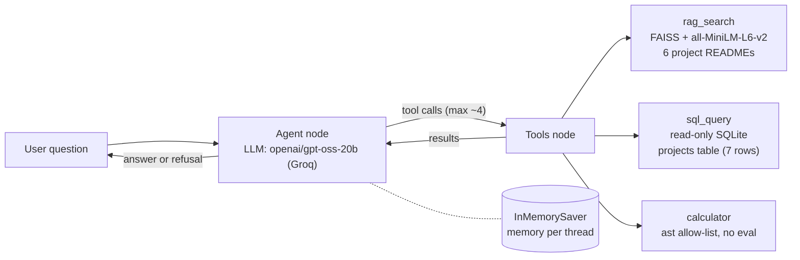
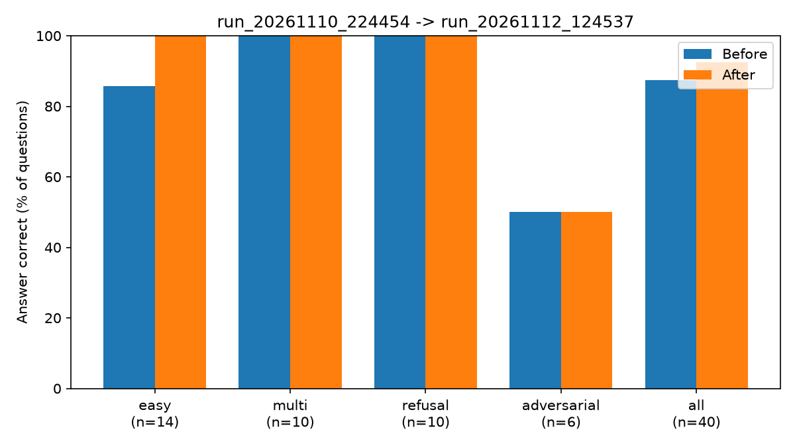

# Tool-calling agent with an evaluation harness

A LangGraph agent that answers questions about my portfolio projects. For each question it decides whether to **search my project READMEs**, **query a small SQLite table**, **use a calculator**, or **refuse**. The main part of the project is the **evaluation harness**: 40 scored questions, a baseline, two measured fixes, and an honest list of what the numbers do and do not show.

Built as a learning and portfolio project. Every design choice below is one I can explain.

## Architecture



- **Agent loop:** a custom LangGraph `StateGraph` (agent node <-> tool node). A router sends tool calls to the tool node, and anything else ends the turn.
- **Tool limit:** about 4 tool calls per question. At the limit the model must answer from what it has; if it still asks for a tool, the agent returns a fixed refusal.
- **Memory:** a LangGraph checkpointer keeps the conversation per `thread_id`, so follow-up questions work.
- **Refusal:** one fixed phrase, "I don't know based on my documents.", used by the prompt and by the scorer.

### Tools and their safety measures
| Tool | What it does | Safety |
|---|---|---|
| `rag_search` | Top-5 chunks from 6 READMEs (600-char chunks, 100 overlap, document title prepended) | Index is checked to match the embedding model in config |
| `sql_query` | One SELECT on the `projects` table | Layer 1: single SELECT only. Layer 2: database opened read-only. 5 s time limit, 50-row limit |
| `calculator` | Arithmetic: numbers, + - * / ** %, parentheses | Python `ast` allow-list (no `eval`); all numbers as floats so huge powers fail fast |

Tool errors are returned to the model as text, so a failing tool never crashes a run.

## Results

40 questions: 14 easy (one tool), 10 multi-step (two tools or a memory follow-up), 10 refusal, 6 adversarial (false premises, an instruction-override attempt, a related-but-out-of-scope question).

| Version | Commit | Answer correct | Tool selection | Avg tool calls | Avg latency (s) | Avg tokens |
|---|---|---|---|---|---|---|
| Baseline | fb2ee80 | 88% (35/40) | 95% (38/40) | 1.6 | 18.1 | 3075 |
| + Fix 1: document title in every chunk | e641f40 | 95% (38/40) | 98% (39/40) | 1.5 | 17.7 | 2745 |
| + Fix 2: try the other source before refusing (final) | 7f0958d | 92% (37/40) | 98% (39/40) | 1.6 | 20.7 | 3316 |
| Final, second run (variance check) | 7f0958d | TODO | TODO | TODO | TODO | TODO |



**Baseline vs final, read carefully:** +5 points (88% -> 92%) comes from two flipped questions. One (`easy-01`) is clearly the effect of Fix 1. The other (`easy-14`) never used retrieval, so its flip is run-to-run variation. A false-premise question (`adv-04`) was fixed in the Fix 1 run and failed again in the final run. The confidently attributable gain is therefore about one question (+2.5 points), at the cost of higher latency (18.1 s -> 20.7 s) and tokens (3075 -> 3316). The variance row in the table above shows how much the same code moves between runs.

All runs: single run each, `openai/gpt-oss-20b`, temperature 0. Raw CSVs, per-run tables and charts are in `results/`.

### What the fixes did

**Failure analysis of the baseline.** All 5 failures were real agent failures (no scorer bugs), in three types:
1. Retrieval missed chunks that do not name their project. The brain-tumor results table never says "brain tumor", so it was not retrieved (2 failures, each using all 4 tool calls).
2. No fallback to the SQL table when the READMEs had nothing (2 failures).
3. Scope and premise judgment: refusing an on-topic question, and accepting a false premise (2 failures, one shared with type 1).

**Fix 1: document title prepended to every chunk.** Fixed both type-1 questions, and cut their tool calls from 4 to 1. A third question also flipped to correct, but it never used retrieval, so that flip was run-to-run variation, not the fix. Honest attribution: about +5 points from Fix 1, about +2.5 from noise.

**Fix 2: prompt rule and tool description saying the two sources cover different things.** Verified by trace: when the READMEs have nothing, the agent now checks the SQL table (before, it never did). On this eval it did not raise accuracy: the targeted question still ended in a refusal because the table has no "what it does" column, and one false-premise question flipped back to a refusal. It also cost about +21% tokens and +3 s per question, because the agent now checks both sources before refusing. I kept it because it is the right behaviour for questions about projects that exist only in the table, and I stopped tuning to avoid overfitting to these 40 questions.

**Not fixed (stated limitation):** failure type 3. Example: told that CampusEYE was a solo project, the agent lists its real contributions but does not say it was a team of four.

## How the evaluation works

Each question in `eval/questions.jsonl` has acceptable **tool sets**, an answer type, and a note on where the expected answer comes from.

- **Tool selection:** the set of tools used must exactly match one of the acceptable sets (order and repeats ignored). Unneeded tools count as a failure.
- **Answer correctness:** `number` (any number in the answer within ±0.01), `keywords` (groups of synonyms, all required, case-insensitive), or `refusal` (the fixed phrase). A `forbidden` list fails answers that leak a wrong fact.
- **Groundedness (numbers only):** every number in the answer must appear in the question, the tool arguments or the tool outputs. Answers without numbers are "n/a", so refusals cannot inflate the rate.
- **Latency and tokens:** wall-clock time and the provider's token counts (approximate; includes the model's hidden reasoning tokens).
- Each question runs in a fresh thread; errors are recorded per question and shown separately, never hidden inside accuracy.

The scorer was checked against real model output. Reading failures found two scorer bugs before the baseline: curly apostrophes, and invisible characters (`\u202f` narrow no-break spaces, `\u2011` non-breaking hyphens) that made a correct answer fail. Both are now regression tests. A manual review of 10 scored answers agreed with the automatic scorer on all 10. No LLM judge is used.

## Limitations: why these numbers may overstate quality

1. **Builder-written test set.** The questions were drafted with AI help and reviewed by me, from the same 6 READMEs, after seeing failures. Real users ask messier questions.
2. **Small sample, single runs.** For 35/40 the 95% confidence interval is roughly 74% to 95%. One adversarial question moves its category by 17 points. Temperature 0 still varies between runs (one question flipped with no relevant change).
3. **Lenient automatic scoring.** Several acceptable tool sets, substring keywords, any-number matching, refusal phrase anywhere. Groundedness checks numbers only; made-up text claims are not caught.
4. **The refusal category rewards a do-nothing agent.** Refusing everything would score 100% on refusal questions (30% overall). Category scores do not show whether the agent can tell categories apart.
5. **Toy-sized world.** 55 chunks and 7 database rows; one README is 56% of all chunks.
6. **Ambiguous questions found after the fact.** Two adversarial questions turned out to depend on judgment ("What does X do?" when only domain and framework are stored; "Why did it reach 99.91% validation accuracy?" when the docs never say why). I did not change them after seeing results.
7. **CI covers only the deterministic parts** (calculator, SQL tool, scoring). It does not run the agent, the LLM or retrieval.
8. **Cost limits evaluation.** Groq's free tier allows 200,000 tokens per day; one full run uses about 130,000. Repeated runs to average out noise are not free.
9. **Correct arithmetic is not a meaningful comparison.** Asked for the difference between the brain tumor and skin cancer accuracy, the agent answers "8.43%". The subtraction is right, but the comparison says little: (a) the unit is 8.43 *percentage points*, not 8.43% (relative to 90 it is about 9.4%); (b) the two models solve different tasks on different data: 2 classes from brain MRI scans vs 7 classes from skin images (HAM10000), so the same accuracy does not mean the same difficulty; (c) the numbers may not measure the same thing: 98.43% is validation accuracy, while the skin cancer README does not say whether its 90% is training, validation or test accuracy; (d) accuracy alone hides class imbalance: in HAM10000 about two-thirds of images are one class (melanocytic nevi), so always predicting that class would already score about 67%, and neither README reports per-class recall. The agent computes the number without these caveats, and the eval scores it as correct, because it checks the arithmetic, not whether the comparison makes sense.
## Setup

Requires Python 3.12 and a free Groq API key (https://console.groq.com).

```powershell
git clone https://github.com/VirajBarapatre/Agentic-RAG-Portfolio.git
cd Agentic-RAG-Portfolio
python -m venv venv
.\venv\Scripts\Activate.ps1          # macOS/Linux: source venv/bin/activate
pip install -r requirements.txt
copy .env.example .env               # macOS/Linux: cp .env.example .env
```

Open `.env` and add your key after `GROQ_API_KEY=`. Never commit `.env` (it is in `.gitignore`).

Build the database and the search index (both are generated, not committed):
```powershell
python -m src.build_db
python -m src.ingest
```

## Usage

**Chat demo** (prints every tool call `->` and result `<-`):
```powershell
python -m scripts.chat
```

**Run the evaluation** (uses about 130,000 tokens; the free tier allows 200,000 per day):
```powershell
python -m src.eval.run_eval            # all 40 questions -> results/run_<time>.csv
python -m src.eval.run_eval 3          # quick check on the first 3
python -m src.eval.summarize           # table + chart for the newest run
python -m src.eval.compare results/run_A.csv results/run_B.csv
```

**Tests** (no API key needed):
```powershell
pip install -r requirements-test.txt
python -m pytest -v
```

## Project structure

```
data/docs/           6 project READMEs (frozen snapshot used by the eval)
eval/questions.jsonl 40 evaluation questions
results/             every run: CSV, summary table (.md), chart (.png), comparisons
scripts/             chat.py (demo), try_rag.py (retrieval check)
src/config.py        all settings and paths
src/ingest.py        docs -> chunks -> embeddings -> FAISS index
src/retriever.py     loads the index, top-k search
src/build_db.py      builds the projects table
src/llm.py           Groq chat model
src/agent.py         LangGraph agent, prompt, run_question()
src/tools/           rag_search, calculator, sql_query, LangChain tool wrappers
src/eval/            scoring, run_eval, summarize, compare
tests/               pytest tests (no LLM)
```

## Tech stack

Python 3.12, LangGraph, LangChain Core, Groq (`openai/gpt-oss-20b`), FAISS, sentence-transformers (`all-MiniLM-L6-v2`), SQLite, matplotlib, pytest, GitHub Actions.

**Related project:** [Ask My Portfolio](https://github.com/VirajBarapatre/ask-my-portfolio-rag) is my deployed single-step RAG chatbot ([live demo](https://virajs-ask-my-portfolio.streamlit.app)). This project is the follow-up: a tool-calling agent with an evaluation harness.